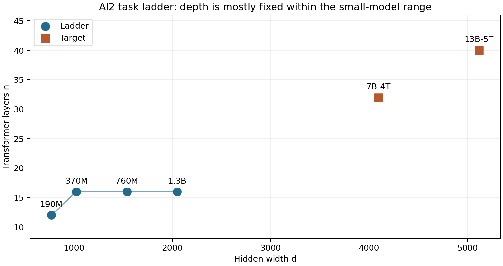

::: {.callout-note}
See the [pinned MoE architecture comparison](moe-families.qmd) for Qwen3/OLMoE/Marin configurations, including Qwen3's attention-width distinction. Powers of two are a convenient candidate set; actual dimension/sharding constraints and throughput decide feasibility.
:::


::: {.callout-note}
For the latest conversation evidence and **96-GPU × 30-day** allocation, see the [industry audit](../workflow/industry-practice-audit.qmd), [data-engineering companion](../data/marin-data-engineering.qmd), [trainer playbook](../training/trainer-playbook.qmd), [checkpoint evaluation](../evaluation/checkpoint-evaluation.qmd), and [current numerical plan](../plans/plan-96-h100.qmd). Earlier 128×40 examples remain historical alternatives.
:::


Your observation about AI2 is substantially correct: three of its four small ladder sizes share **16 layers**. But its larger target models use **32 and 40 layers**. The paper demonstrates task prediction across that particular recipe; it does not establish that keeping depth fixed is optimal, or that μP transfers hyperparameters across those depth changes. Those are distinct empirical questions. [Bhagia et al., *Establishing Task Scaling Laws*, v2, §2.1 and Table 1](https://arxiv.org/html/2412.04403v2#S2.T1).

This guide develops the architecture and transfer questions in [your deep-dive notes](../reading/deep-dive-notes.qmd), especially §§4.2–4.3 and 6.2–6.4. **Reported practice**, **mathematical consequences**, and **our proposed experiments** are labeled separately. Jiaxuan's [original blog copy](../reading/scientific-scaling-ladder.md) remains available.

The earlier MoE experiment is specified in [the 128-H100 historical candidate](../plans/hero-h100-candidate.qmd), using [SMELT’s two-pass middle-loop evidence](smelt-looped-moe.qmd) and an explicit overtraining/serving constraint.

## Architecture decision flow

This is our proposed decision process, informed by the experiments below. Green validation gates require measurements; the chart does not select a final configuration without deployment and compute constraints.

```{mermaid}
%%| fig-cap: "Architecture selection: distinguish width-transfer experiments, shape experiments, and target-scale prediction."
flowchart TB
    A[Define workload, context, serving memory and training budget] --> B{Choose a candidate family}
    B -->|Dense Transformer| C[Freeze attention, FFN, tokenizer, precision and target depth]
    B -->|Hybrid or MoE| D[Also specify layer pattern, active experts, latent width and routing]
    D --> C
    C --> E{Which uncertainty comes first?}
    E -->|Hyperparameter transfer across width| F[Hold depth, batch and token horizon fixed]
    F --> G[Declare full muP convention and sweep a narrow proxy]
    G --> H{LR transfer and stability pass at wider sizes?}
    H -->|No| G
    H -->|Yes| I[Record validated width rule]
    E -->|Best width versus depth| J[Compare matched-budget shape alternatives]
    J --> K[Retune LR and residual scale; measure quality and throughput]
    K --> L{Shape ranking persists at a second scale?}
    L -->|No| J
    L -->|Yes| M[Select a tested shape progression]
    I --> N[Check remaining width or depth uncertainty]
    M --> N
    N --> O[Calibrate batch, LR, decay and schedule across token horizons]
    O --> P[Train size-by-token ladder with target-like data exposure]
    P --> Q{Untouched larger holdout and production stack pass?}
    Q -->|No| R[Diagnose; revise recipe; reserve a fresh holdout]
    R --> E
    Q -->|Yes| S[Freeze the complete architecture and training recipe]
    classDef gate fill:#e5f4eb,stroke:#28784b,color:#152b20
    class H,L,Q gate
```

For a concrete hybrid/MoE example, see the [Nemotron pretraining case study](../efforts/nemotron-pretraining.qmd). Its “layer count” counts a hybrid stack and must not be compared directly to AI2's Transformer-block count.

## What exactly did AI2 scale?

### Reported practice: all six configurations

The following values are transcribed from Table 1, not inferred from a scaling-law fit. $N$ is the paper's reported non-embedding count; $d$ is hidden width; $n$ is layer count. Token batch sizes correspond to sequence length 4,096.

| Model | Role | $d$ | $n$ | Heads | $d$/heads | MLP ratio | Batch tokens | Peak LR |
|---|---|---:|---:|---:|---:|---:|---:|---:|
| 190M | Fitting ladder | 768 | 12 | 12 | 64 | 8 | 524,288 | 0.00097 |
| 370M | Fitting ladder | 1,024 | 16 | 16 | 64 | 8 | 786,432 | 0.00078 |
| 760M | Fitting ladder | 1,536 | 16 | 16 | 96 | 8 | 1,310,720 | 0.00061 |
| 1.3B | Fitting ladder | 2,048 | 16 | 16 | 128 | 8 | 1,572,864 | 0.00052 |
| 7B-4T | Target | 4,096 | 32 | 32 | 128 | 5.375 | 4,194,304 | 0.00030 |
| 13B-5T | Target | 5,120 | 40 | 40 | 128 | 4 | 8,388,608 | 0.00090 |

Source: [AI2 Table 1](https://arxiv.org/html/2412.04403v2#S2.T1); [local LaTeX table](../../references/evaluation/2024-ai2-task-scaling-model-ladders/source/floats/hparams.tex). The complete transcription, including exact $N$ and warmup steps, is in [this CSV](../artifacts/ai2-ladder-configs.csv). “MLP ratio” retains the table's terminology; reproduce its implementation convention before calculating FFN dimensions.



AI2 trains each fitting size for $D=20N\times\{1,2,5,10\}$, giving 16 runs. LR, batch size, and warmup are extrapolated from its 7B configuration using Porian et al.'s method. The paper does **not** identify this as a μP experiment or report exhaustive independent LR/batch tuning at every point. [AI2 §2.1](https://arxiv.org/html/2412.04403v2#S2.SS1).

### What this evidence establishes

1. Depth is **piecewise constant** in the fitting range, not constant throughout the whole family.
2. Between 370M and 1.3B, width doubles while depth stays 16, but head dimension changes from 64 to 128. This is not an isolated width change with all attention details fixed.
3. Target extrapolation also changes depth and MLP ratio. The forecast tests the combined recipe, not separate width/depth effects.
4. The 13B target has a peak LR three times the 7B target's LR. The table itself contradicts treating “larger model → lower raw LR” as an unconditional rule.

The paper's abstract reports prediction within two absolute accuracy points on four ranked-classification tasks for both targets. That is evidence for task-specific predictive success, with task-dependent limitations; it is not an architecture-optimality result. [AI2 abstract and §4](https://arxiv.org/html/2412.04403v2).

## Why keep depth fixed in a small-model ladder?

There are at least three different experiment designs.

| Goal | What to vary | What fixed depth buys | What it cannot establish |
|---|---|---|---|
| μP hyperparameter transfer | Width at a chosen depth | Separates width from depth in the transfer check | Transfer to a different depth |
| Optimizer comparison | Width/model size, horizon, optimizer | Controls one source of architecture variation | Best aspect ratio at target scale |
| Target capability prediction | A prescribed family plus tokens | A cheaper, reproducible fitting family | Causal attribution of shape effects |

**Concrete optimizer example.** Fantastic Optimizers uses 32 layers throughout: widths 512, 768, 1,024, and 1,536; head counts 8, 12, 16, and 24; FFN dimensions 2,048, 3,072, 4,096, and 6,144. Thus head dimension remains 64. Its four approximate sizes are 130M, 300M, 520M, and 1.2B. It evaluates optimizer comparisons over multiple horizons. This is an actual fixed-depth benchmark design; its purpose is optimizer evaluation. [Wen et al., v2, §3 and Table 2](https://arxiv.org/pdf/2509.02046v2); [local PDF](../../references/optimization/2025-fantastic-pretraining-optimizers/paper.pdf).

**Concrete shape study.** Gemstones deliberately explores 22 models with widths 256–3,072 and depths 3–80, spanning roughly 50M–2B parameters. It provides the kind of cross-shape evidence that a single width trajectory cannot provide. Its training procedure and evaluation conditions still matter when transferring conclusions. [McLeish et al., v3, §3](https://arxiv.org/pdf/2502.06857v3); [local PDF](../../references/scaling-laws/2025-gemstones-width-depth-scaling/paper.pdf).

**Interpretation:** fixed depth can make an experiment cleaner or cheaper. Neither AI2 nor the fixed-depth optimizer benchmark proves that depth should stay fixed as production models grow.

## What μP actually changes when width increases

### The mathematical problem

For an MHA Transformer with a conventional two-matrix FFN of expansion four,

$$N_{\mathrm{body}}\approx12nd^2.$$

Therefore doubling $d$ at fixed $n$ roughly quadruples trunk parameters. Doubling $n$ at fixed $d$ roughly doubles them. Gated FFNs, grouped-query attention, and embeddings change these counts. The equation explains geometry; it does not select the best width/depth ratio.

μP addresses how initialization, forward multipliers, and optimizer updates behave when width changes. It does not by itself solve the architecture allocation problem. A **base LR** can transfer while the **actual LR assigned to a hidden matrix** changes with width. [Yang et al., Tensor Programs V, Tables 3/8 and Appendix B.1](https://arxiv.org/pdf/2203.03466v2).

### A concrete μP convention: Table 8 with Adam

Let $d_0$ be base width and $r=d/d_0$. Assume all hidden dimensions scale by the same $r$, vocabulary remains fixed, and use the equivalent formulation in Table 8. The following are relative changes from the base model, with independent tunable constants suppressed.

| Parameter group | Initialization standard deviation | Actual Adam LR | Forward rule |
|---|---|---|---|
| Hidden attention/FFN matrices | Multiply by $r^{-1/2}$ | Multiply by $r^{-1}$ | Ordinary linear map |
| Input embeddings | Constant in width | Constant in width | Ordinary lookup |
| Norm scales/biases | Preserve prescribed initialization | Constant in width | Normalization as specified |
| Output readout | Constant in width in this convention | Constant in width | Multiply output by $r^{-1}$ |

This is **one complete convention**. Table 3 uses a different readout parameterization with correspondingly different LR/initialization rules. Mixing a readout from one table with hidden-matrix rules from another can change the model. Biases and tied embeddings also require their defined treatment. Use the paper's implementation or a fully specified equivalent. [Tensor Programs V, Table 8 and Appendix B.1](https://arxiv.org/pdf/2203.03466v2); [local LaTeX/source](../../references/optimization/2022-mup-zero-shot-hyperparameter-transfer/arxiv-source.tar).

For example, increasing width from 512 to 2,048 means $r=4$. In the Table 8 convention, hidden-matrix initialization standard deviation halves, hidden-matrix Adam LR becomes one quarter, and the readout multiplier becomes one quarter; the tuned base LR remains the same. These are derived ratios, not new empirical optima.

For attention, the original Transformer μP formulation also uses attention-logit scaling proportional to $1/d_{\mathrm{head}}$ rather than $1/\sqrt{d_{\mathrm{head}}}$. Appendix B.1 gives a base-compatible multiplier $\sqrt{d_{\mathrm{head},0}}/d_{\mathrm{head}}$. If head dimension stays fixed and only head count grows, that particular multiplier stays fixed. This is why a documented rule for head dimensions matters. [Tensor Programs V, Appendix B.1](https://arxiv.org/pdf/2203.03466v2).

### Reported width-transfer experiment

Tensor Programs V §7.4 uses a **32-block, width-4,096 GPT-3-style 6.7B target** and a **width-256, roughly 40M proxy at the same depth**. The width ratio is 16; proxy tuning cost is reported as 7% of pretraining compute. Table 7 reports validation loss 1.98 for the μP model versus 2.03 for the rerun baseline. The authors disclose different attention choices in the baseline and FP32 versus FP16 training, so the difference is not a clean attribution of all gains to μP. It is nevertheless a concrete demonstration of tuning at much smaller width while retaining target depth. [Yang et al., §7.4 and Table 7](https://arxiv.org/pdf/2203.03466v2).

A second practice example is Power Lines: a **39M proxy, width 256, 24 layers, head dimension 64**, trained for **800M tokens**, batch **256 sequences × 2,048 tokens**, with **350 sampled hyperparameter configurations**. It tunes base LR, initialization, and embedding/readout factors before using μP in the main experiments. [Bergsma et al., v2, Appendix C, “Proxy model hyperparameter tuning”](https://arxiv.org/pdf/2505.13738v2).

## Can we increase depth using the same recipe?

Ordinary width μP does not give an unconditional rule for changing depth. Tensor Programs V includes empirical transfer beyond width with caveats; Tensor Programs VI studies specific infinite-depth parameterizations. The latter's favorable depth-transfer result assumes one layer per residual block; its discussion of multi-layer blocks explains why a simple extension is insufficient. This is not a theorem that every Transformer depth-transfer method must fail. [Tensor Programs V, §6.1](https://arxiv.org/pdf/2203.03466v2); [Tensor Programs VI, abstract, Table 1 and discussion of block depth](https://arxiv.org/pdf/2310.02244).

For a Transformer, changing depth adds new blocks, changes residual accumulation and gradient paths, and may change the best residual multiplier or optimizer settings. A rule such as multiplying residual branches by $n^{-1/2}$ is a declared parameterization to test, not an established universal scaling law for the full modern pretraining recipe.

**Our proposed depth experiment:** at an intermediate budget, compare two or three width/depth pairs with closely matched counted parameters, then account for their actual FLOPs and throughput. Retune LR/residual scale enough to avoid penalizing one shape for a bad optimizer setting. Repeat at a second budget, recording loss, downstream scores, stability, memory, and time. Choose a shape progression only after checking that the ordering transfers.

## How do batch size and learning parameters scale?

### AI2: a prescribed recipe, not a width theorem

AI2's four ladder batches increase from 524,288 to 1,572,864 tokens while peak LR decreases from $9.7\times10^{-4}$ to $5.2\times10^{-4}$. These are observed configuration choices extrapolated using Porian et al.'s method. Size and horizon co-vary within this ladder; these entries do not isolate a causal dependence on width. [AI2 §2.1 and Table 1](https://arxiv.org/html/2412.04403v2#S2.SS1).

### Two measured horizon laws with different conditioning

| Study and version | Reported batch result | Conditions that matter |
|---|---|---|
| Step Law v3, Eqs. 1–2/Table 2 | $B_{\mathrm{tokens}}=0.58D^{0.571}$ | Jointly searched LR/batch; dense/MoE and data experiments under its recipe |
| Power Lines v2, Table 5 | $B_{\mathrm{sequences}}=0.0306D^{0.383}$ | 2,048-token sequences; AdamW/μP, SlimPajama, tuned weight decay |

$D$ is the total token count, not the number of optimizer steps. **The batch units differ.** In Power Lines, token batch is 2,048 times the reported sequence batch. At $D=10^{10},10^{11},10^{12}$ tokens, Table 5 projects approximately 207, 500, and 1,207 sequences, or 423,936, 1,024,000, and 2,471,936 tokens. These are rounded projections from a fit, not three independently measured optima. [Step Law v3](https://arxiv.org/pdf/2503.04715v3); [Power Lines v2, Table 5 and Appendix E.2](https://arxiv.org/pdf/2505.13738v2); [local batch table](../../references/optimization/2025-power-lines-batch-size-weight-decay/source/tables/tab_wd_bopt.tex).

Holding all other conditions compatible, an eightfold longer horizon gives batch multipliers $8^{0.571}\approx3.28$ and $8^{0.383}\approx2.22$, respectively. Those different measured exponents are evidence to calibrate locally, not a single universally agreed batch law.

Step Law v3 jointly fits

$$\eta_*(N,D)=1.79N^{-0.713}D^{0.307}.$$

By contrast, Bjorck et al. study optimal LR as horizon changes under fixed batch conditions and find a decreasing dependence on horizon. These are different conditional optimizations. A larger optimal batch can accompany a larger optimal LR; one should not copy Step Law's raw LR formula onto a μP base LR without checking definitions and parameter groups. [Step Law v3, Table 1](https://arxiv.org/pdf/2503.04715v3); [Bjorck et al., 2024](https://arxiv.org/pdf/2409.19913).

### Weight decay: a correction to the notes

With token batch $B$, token horizon $D$, peak LR $\eta$ in the paper’s μP/decay convention, and weight decay $\lambda$, Power Lines uses

$$\tau=\frac{B}{\eta\lambda D},\qquad
\tau_*\approx1.084(D/N)^{-0.527}.$$

At fixed $N,D,\eta$, preserving $\tau$ predicts $\lambda\propto B$ in the supported batch regime. **Across changing TPP, optimal $\tau$ is not constant.** The derived recipe is

$$\lambda_* = \frac{B}{\eta D\,1.084(D/N)^{-0.527}}.$$

Increasing $D$ by four at fixed $N$ lowers the fitted $\tau_*$ by $4^{-0.527}\approx0.48$. The notes' constant-timescale statement therefore needs this qualification. The paper also shows that fitted batch exponents change with fixed decay: 0.120 at $\lambda=0.025$, 0.429 at $\lambda=0.1$, and 0.383 with tuned decay. A batch law and its decay-tuning policy belong together. [Power Lines v2, §2.4, Fig. 1 and Table 5](https://arxiv.org/pdf/2505.13738v2).

### Other settings to record explicitly

| Setting | What to check empirically |
|---|---|
| Warmup | Fraction of tokens/steps; AI2's four 1× ladder entries use approximately 5% of steps, rather than one fixed count |
| Adam $\beta_1,\beta_2$ | Their units are optimizer steps; changing token batch changes the token span of optimizer memory |
| Weight-decay groups | Embeddings, norms and matrices may have different policies; μP implementations can transform decay along with LR |
| Schedule and final LR | Match the endpoint convention; do not rank WSD candidates solely before decay |
| Precision and clipping | Test the actual update and stability in production precision |
| Context/packing | Keep token accounting fixed and recompute attention FLOPs when context changes |
| MoE | Track active and total parameters, routing and balancing; dense width rules do not identify expert-count effects |

For intuition only, a step-decay memory $\beta$ has token e-folding span $-B/\ln\beta$. Maintaining that span when batch changes from $B_0$ to $B_1$ gives $\beta_1=\beta_0^{B_1/B_0}$. This is a derivation, not evidence that preserving the span is always optimal. It still needs a sweep or a validated recipe.

## A practical first experiment for this repository

The following is **our proposed design**, not a claim that AI2 used it.

1. **Declare a target shape.** Freeze depth, head dimension, GQA ratio, FFN rule, context, precision, tokenizer and data. Keep an explicit checklist of deliberate departures from AI2.
2. **Check width transfer alone.** At fixed depth, batch and token horizon, compare widths such as 512, 768 and 1,024. With head dimension 128 these correspond to 4, 6 and 8 MHA heads. Compare ordinary parameterization and a fully specified μP implementation; sweep base LR on the smallest and spot-check it at the next two widths. Count actual parameters.
3. **Check shape separately.** At a second scale compare matched-budget depth alternatives. Changing depth requires a transfer check even if the width experiment passed.
4. **Calibrate horizon and batch.** At the selected shape, vary $D$ and sweep token batch around a locally fitted law. Tune or jointly model decay. Distinguish minimizing loss at fixed tokens from minimizing training time.
5. **Fit the production ladder.** Use the chosen shape progression and validated hyperparameter rules across size/token points. Retain a larger unseen tier and the target TPP regime.
6. **Test the full target-like stack.** Confirm task rankings, annealed loss, long-horizon stability, throughput and memory. A gain confined to small widths is insufficient for the target decision.

The first milestone is a measured answer to “does this exact implementation transfer across width at fixed depth?” The next milestone is a separate answer about depth and horizon. This prevents task-prediction success from being mistaken for an experimentally identified architecture optimum.
