## Navigate from the decision

[Editable Mermaid source](../assets/pretraining-workflow.mmd). The SVG is a derived navigation figure, not an empirical result.

## Canonical pages

- [Compute, parameters and a constrained hero budget](<compute-accounting.md>) — `runnable`; Offline CPU record/configuration checks or analytical fixtures; not model training.
- [Scoped scientific claim ledger](<../governance/claim-ledger.md>) — `concept`; Evidence synthesis and navigation; not an executable training recipe.
- [Knowledge coverage, unresolved inputs and review dates](<../governance/coverage.md>) — `concept`; Evidence synthesis and navigation; not an executable training recipe.
- [A rigorous pretraining knowledge base: evidence and reproduction](<../governance/evidence-standard.md>) — `concept`; Evidence synthesis and navigation; not an executable training recipe.
- [Diagnosing a failed scaling or training decision](<../patterns/failure-diagnosis.md>) — `concept`; Evidence synthesis and navigation; not an executable training recipe.
- [Marin replication: a stage-by-stage evidence and acceptance contract](<../recipes/marin-reproduction.md>) — `runnable`; Offline CPU record/configuration checks or analytical fixtures; not model training.
- [Offline workbench: public records and analytical fixtures](<../recipes/offline-workbench.md>) — `runnable`; Offline CPU record/configuration checks or analytical fixtures; not model training.
- [Data-mixture experiments: supply, exposure, controls and transfer](<../techniques/data-mixture-design.md>) — `runnable`; Offline CPU record/configuration checks or analytical fixtures; not model training.
- [Evaluation contracts: losses, capabilities, contexts and failures](<../techniques/evaluation-contract.md>) — `runnable`; Offline CPU record/configuration checks or analytical fixtures; not model training.
- [Width, batch and horizon: a conditional hyperparameter-transfer protocol](<../techniques/hyperparameter-transfer.md>) — `runnable`; Offline CPU record/configuration checks or analytical fixtures; not model training.
- [Identifiable scaling fits and independent larger holdouts](<../techniques/scaling-fit.md>) — `runnable`; Offline CPU record/configuration checks or analytical fixtures; not model training.

## Literature and companion guides

The [full literature catalogue](../../references/SOURCES.md) retains PDFs/LaTeX/code. [Long-form guides](../../doc/index.qmd) explain the original blog and team efforts. [Question contracts](../../queries/by-problem.md) expose unanswered inputs.
